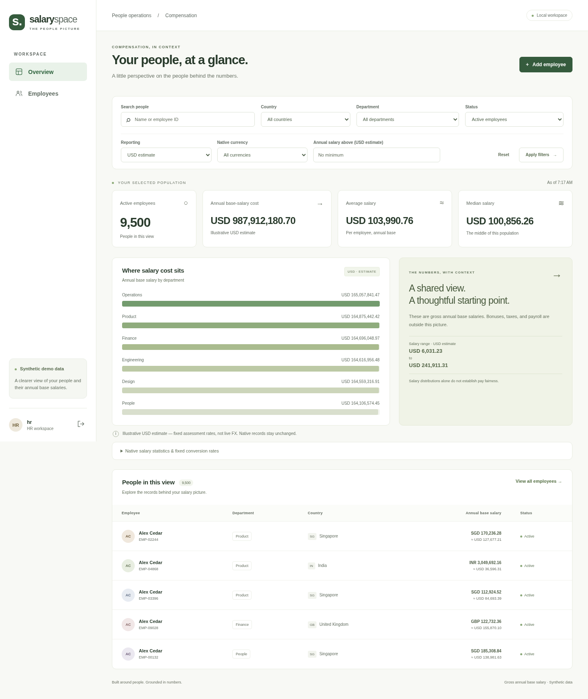
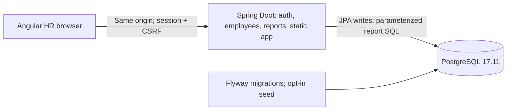

# Salaryspace

A local HR compensation workspace built for the Incubyte salary-management assessment: find employees, maintain current annual base salaries, and explore salary cost across countries and departments.

Angular → one Spring Boot application → PostgreSQL. Docker builds and serves the frontend with the API under one origin. No paid service, runtime AI, live FX feed, or hosting account is required.

## Run it

Prerequisite: a running Docker engine with Compose v2.20+ (Docker Desktop with Linux containers on Windows/macOS). No host Java, Node, or PostgreSQL installation is needed. Allow several minutes and Internet access for the first image/dependency download. Four GB of Docker memory is a practical starting allocation for builds.

```sh
git clone https://github.com/Chenthan/incubyte-salary-management.git
cd incubyte-salary-management
./scripts/run.sh
```

Windows PowerShell, from the project directory:

```powershell
.\scripts\run.ps1
```

Open **http://localhost:8080**. The script generates an ignored `.env` with unique random local credentials, builds the app, waits for PostgreSQL and application readiness, migrates the schema, and seeds the demo. Display your HR sign-in locally:

```sh
./scripts/run.sh credentials
# PowerShell: .\scripts\run.ps1 credentials
```

There is no shared default password. Keep `.env` private and with its matching database volume. The scripts never reset your database. Changing `.env` does not rotate existing database or HR passwords; see the [runbook](docs/runbook.md).

```sh
./scripts/run.sh stop     # stops services; preserves data
./scripts/run.sh          # rebuilds/restarts safely; preserves edits
./scripts/run.sh logs     # application logs
APP_PORT=8081 ./scripts/run.sh  # choose another local port
```

The application port binds to **127.0.0.1 only**; PostgreSQL has no host port. Local HTTP deliberately uses `COOKIE_SECURE=false`. This is a local deployment, not a public HTTPS hosting configuration.

## See the application

The [recorded browser demo](docs/demo.mp4) demonstrates sign-in, filtered browsing, employee creation, a salary edit reflected in reports, deactivation, and sign-out. [Phone screenshot](docs/screenshots/overview-phone.png) · [Employee detail](docs/screenshots/employee-detail.png).



## What it does

- One HR role with server-side session authentication, hashed passwords, CSRF protection, and sign-out.
- Employee create/edit/detail and reversible deactivation, with visible stale-edit conflict recovery.
- Shared search, country, department, status, currency, and salary-threshold filters for paginated records and reports.
- Count, annual base-salary total, mean, numeric median, minimum, maximum, and department cost drill-down.
- Exactly **10,000 deterministic seeded employees** on a fresh database, across six countries and six currencies; **9,500 active** and 500 inactive. Browser-created records are additional records. Repeat seeding preserves edits.
- Decimal native salaries plus clearly labelled **illustrative USD estimates** using a documented fixed-rate table. Currencies are never added into a currencyless native total.

Current records keep the workflow small and explainable. They cannot reconstruct past salaries. Imports, payroll, taxes, compensation projections, approval workflows, exports, and runtime AI are outside this release. [Requirements](docs/requirements.md) · [Decision register](docs/decisions.md).

## Architecture and money



One modular backend and two runtime services keep local operation simple. The cost is coupled frontend/backend releases and single-instance sessions. Salary writes use optimistic locking; a stale edit returns 409 instead of silently overwriting another change. Lists and reports run on the server rather than downloading the dataset to the browser.

Native amounts use `BigDecimal` / `NUMERIC(12,2)`. Converted arithmetic keeps intermediate precision; reported amounts round half up to two decimals. The frontend formats decimal strings without converting authoritative totals to JavaScript floating point. [Money rules and rate table](docs/money.md) · [Full technical design](docs/design.md) · [API examples](docs/api.md).

## Verify it

Docker-only backend unit/PostgreSQL integration tests and frontend format/unit/type checks:

```sh
./scripts/test.sh
```

The test database is separate and disposable. This command never resets the demo volume. Browser checks require Node 24.19.0/npm 11.9.0 and the running application:

```sh
cd frontend
npm ci --no-fund
npx playwright install chromium
npm run e2e
```

The suite exercises the flow at 1440×1080 and 390×844, including salary validation, a real stale-edit conflict/reload, refreshed reports, filtering, pagination, empty states, sign-out, and axe WCAG A/AA checks on the overview. Automated checks complement visual/keyboard review; they are not an accessibility certification.

For development with a JDK 21, `cd backend && ./mvnw test` runs fast tests without Docker/database/network after dependency setup. `./mvnw spotless:check` checks Java formatting. The checksum-pinned Maven Wrapper uses Maven 3.9.16. In `frontend`, `npm test`, `npm run build`, `npm run format:check`, and `npm run typecheck:e2e` provide the individual checks. `npm start` runs Angular with an API proxy to the Compose app.

[Validation evidence and requirement mapping](docs/validation.md) records actual results and limitations. GitHub Actions repeats the Docker, PostgreSQL, frontend, seed, and browser checks from a clean checkout. Read-only sequential performance measurements can be repeated with `python3 scripts/benchmark.py` after startup; this is not a concurrent-user capacity test.

## Pinned versions and review package

Java 21; Spring Boot 4.1.1; Maven 3.9.16; Angular 21.2.25 with CLI/build 21.2.27; TypeScript 5.9.3; RxJS 7.8.2; Node 24.19.0/npm 11.9.0; PostgreSQL 17.11; Playwright 1.64.1. Direct npm dependencies and the lockfile are committed. Container images are pinned by immutable multi-platform digests in the Dockerfile/Compose.

- [Code-review map, interview questions, and video checklist](docs/review-guide.md)
- [AI usage, accepted suggestions, corrections, and real checks](docs/ai-usage.md)
- [Operation, backups, configuration, and deployment limits](docs/runbook.md)
- [Runtime and environment setup](docs/runtime-status.md)

The original assessment redirect returned HTTP 403. The supplied handoff and the user's later scope choices form the documented baseline; original wording remains unverified. This repository is not an assessment submission. No recruiter messages were sent. The public repository contains synthetic data and neutral requirements, not private correspondence or runtime credentials.
