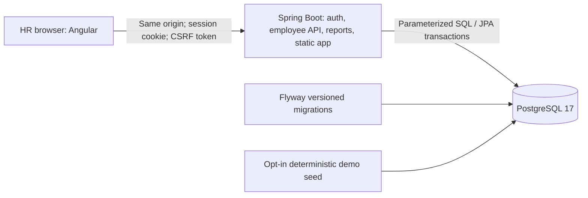

# Technical design

Implemented design, updated 20 October 2026. The user authorized choosing either currency/history approach and selected free local Compose delivery plus a new public repository. Native records with illustrative USD comparison and current-only salaries were chosen under that authorization. See [the decision register](decisions.md), [money rules](money.md), and [actual validation evidence](validation.md).

## Product and architecture

Use a single repository with `backend/`, `frontend/`, `docs/`, and small `scripts/`. A modular Spring Boot application owns authentication, employee writes, reports, and database migrations. Angular provides the HR interface. PostgreSQL stores durable data. This scope does not justify a message broker, cache service, Kubernetes, or independent business microservices.

Build the Angular production assets into the application image and serve them through Spring Boot. Compose initially needs two runtime services: `app` and `db`. The frontend has its own build stage, rather than a permanently running development server. In development the Angular CLI proxy forwards `/api` to Spring Boot.

This gives the browser one origin, avoids production CORS configuration, and makes cookie and CSRF behavior easier to test. Its cost is coupling frontend and backend releases and doing both builds for a production image. A same-origin reverse proxy with separate frontend/API images is a valid alternative if independent releases become important; it adds another runtime service and route/TLS configuration without improving this assessment's core flow.

Separate code by capability (`auth`, `employee`, `reporting`, `demo`, and shared error/configuration code). Controllers validate transport input; services own business rules and transactions; persistence owns queries. Avoid generic base controllers, a repository abstraction around Spring Data just for symmetry, or duplicate domain/persistence models without a concrete need.

### Pinned stack

| Component | Pinned version | Verification / rationale |
| --- | --- | --- |
| Java | 21.0.12.1 in the pinned images | Runtime and compiler executed in real container builds/tests |
| Spring Boot | 4.1.1 | Official Java 21 compatibility; actual compilation, startup, and integration checks pass |
| Maven | 3.9.16 | Official only-script wrapper; distribution SHA-256 committed |
| Angular | 21.2.25; CLI/build 21.2.27 | Exact compatible packages and lockfile; strict production build |
| TypeScript / RxJS | 5.9.3 / 7.8.2 | Within Angular 21 compatibility ranges |
| Node / npm | 24.19.0 / 11.9.0 | Actual installs, unit tests, type checks, and image build |
| PostgreSQL | 17.11 | One immutable image digest for demo and actual integration tests |
| Testing | Boot-aligned JUnit; Angular-supported runner; Playwright | Real PostgreSQL integration coverage and a small set of user journeys |

Official sources checked on 19 October 2026: [Angular compatibility](https://angular.dev/reference/versions), [Spring Boot system requirements](https://docs.spring.io/spring-boot/system-requirements.html). Exact artifacts were resolved and installed; builds and PostgreSQL/browser tests executed. Package/image pins, not mutable documentation pages, are the reproducibility source. No pre-existing code constrained the Spring Boot major.

## Data model and lifecycle

### Employee

| Field | Representation and rules |
| --- | --- |
| `id` | UUID primary key; immutable internal identity |
| `employee_code` | Unique, nonblank HR-facing identifier, immutable after creation |
| `first_name`, `last_name` | Trimmed, bounded Unicode text; required; no ASCII-only name restriction |
| `email` | Validated, bounded, case-insensitively unique email; demo addresses use `example.invalid` |
| `country_code` | Foreign key to a supported ISO country code |
| `department_code` | Foreign key to a small department reference table |
| `annual_salary` | `NUMERIC(12,2)` / Java `BigDecimal`, 0.01–9,999,999,999.99 inclusive |
| `currency_code` | Supported ISO 4217 code, explicitly attached to native salary |
| `active` | Boolean; reports and list default to active |
| `version` | Integer/long optimistic-lock version, returned to client |
| `created_at`, `updated_at` | UTC instants; server-assigned, not client-controlled |
| `demo_seed_key` | Nullable unique key for repeatable demo seeding |

Country and salary currency are separate concepts: a country does not prove an employee's contract currency. The initial supported currencies will be currencies with two fractional digits; any later currency with a different minor-unit rule needs an explicit precision policy. Unknown codes are rejected rather than silently converted or relabelled.

Deactivate instead of deleting employees. Deactivation retains the employee for explicit inactive/all-status searches, excludes them from the default active dashboard, and increments their version. Reactivation restores inclusion. There is no hard-delete endpoint in this release. Uniqueness still applies to inactive employee codes and emails.

No salary-change audit is implied by timestamps or optimistic locking. Current-only records cannot answer “what did this employee earn last quarter?” or reconstruct previous headcount/cost. If effective-dated history is selected, add a salary-period table and as-of filtering before implementation; do not bolt historical questions onto mutable current rows.

### HR access

Store HR usernames and password hashes in a separate table. Inject initial demo account configuration at runtime; fail clearly if demo credentials are required but absent. Hash with an appropriate Spring Security encoder, never persist plaintext. A single HR authority is enough. Account recovery, invitations, role administration, and federated identity are out of this release.

## Monetary semantics

All amounts represent gross **annual base salary**, excluding bonuses, taxes, payroll schedules, and employer contributions. Authoritative arithmetic uses `BigDecimal` and PostgreSQL `NUMERIC`. API monetary amounts are decimal strings; browser numbers may be used only for chart positioning/display, never for persisted or authoritative totals.

Input precision is two fractional digits. Reject negative, zero, missing, excessive-scale, and out-of-range values with field-specific errors. Do not silently round an entered annual salary into a different stored amount. Keep additional precision for intermediate reporting calculations and round displayed monetary results to two decimals with `HALF_UP`.

### Shared population

One validated filter model determines list, report, and department breakdown population: search, country, department, active/inactive/all status, and optional threshold. The search text is literal rather than an SQL pattern: wildcard characters are escaped. Country/department/status are allowlisted. The default is all active employees.

Every native threshold has an explicit currency; applying “above 100,000” across unrelated currencies is invalid. A threshold is strictly greater than the entered amount. If USD comparison is selected, an explicit USD-estimate mode may filter on the same documented conversion expression as reports. The UI must state which mode is active.

### Native currency view

Return one group per currency, including count, sum, mean, median, minimum, and maximum. There is no global salary sum across currencies. Department cost ranking operates within a selected currency. A global headcount remains valid because people can be counted across currencies.

This option avoids rate assumptions and is easier to defend. Its cost is the inability to provide a single comparable international salary-cost ranking.

### Fixed-rate USD comparison — chosen

Keep native records unchanged and add a clearly labelled **illustrative USD estimate** for comparisons. Reference-data and summary responses include the rate-table version, effective date, rate direction (`USD per 1 native unit`), and estimate label. Rates are fixed assessment assumptions, not market data or live financial advice. The implemented `illustrative-v1` assessment assumptions are documented in [money.md](money.md); they are engineering choices under the user’s authorization, not live or historical quotes.

Use one immutable versioned rate set, with USD identity rate exactly 1 and positive decimal rates for every supported native currency. Compute `native annual salary × USD-per-unit rate`. Retain exact intermediate decimals for totals, rankings, thresholds, and median; round only reported amounts. Consequently, summing individually displayed rounded rows may differ by a cent from the rounded total; document this policy. Missing rates produce an explicit reporting error instead of a partial or understated global total.

Required fixtures: identity; a synthetic 100-native × 0.02-USD-per-native = 2 USD direction check; mixed currencies; missing-rate failure; half-up boundary; and aggregate-versus-per-row rounding. These are arithmetic fixtures, not proposed exchange rates.

### Aggregation details

Compute count and aggregates in PostgreSQL on the filtered population. Mean equals total divided by employee count, not an average of department means. Empty population: count 0, sum 0 within an explicitly requested currency, and null mean/median/minimum/maximum; no invented zero salary observation. With an unselected currency and no matching rows, return no currency groups and a clear empty state.

Median must preserve decimal semantics. Use ordered rows with `row_number` and population count, select the middle row for odd populations or middle pair for even populations, and average as `NUMERIC`. Avoid routing authoritative medians through a floating-point percentile implementation. Sort tied salaries by immutable ID for deterministic ordered rows.

The list and summary apply identical filters but are separate requests. Another HR user's edit can occur between them; an `asOf` timestamp documents freshness but does not promise a cross-request snapshot. The first release refreshes the relevant list/detail/report after a successful edit. Strict point-in-time cross-screen consistency would require a snapshot protocol and is outside this release.

## HTTP API and error behavior

Application endpoints are under `/api`. See [API contracts and examples](api.md). Department costs are returned in the summary transaction.

| Endpoint | Behavior |
| --- | --- |
| `GET /api/auth/csrf` | Obtain CSRF token before login; unauthenticated access permitted |
| `POST /api/auth/login` | Authenticate; rotate session ID; return minimal signed-in identity |
| `GET /api/auth/me` | Current HR identity or 401 |
| `POST /api/auth/logout` | CSRF-protected invalidation; 204 |
| `GET /api/reference-data` | Supported countries, departments, currencies, report modes |
| `GET /api/employees` | Filtered page, total count, page metadata; no full-dataset download |
| `POST /api/employees` | Validated creation; 201 and Location |
| `GET /api/employees/{id}` | Detail, including version; 404 if absent |
| `PUT /api/employees/{id}` | Validated field update with expected version; 409 on stale version |
| `PATCH /api/employees/{id}/status` | Active flag and expected version; idempotent requested state |
| `GET /api/reports/salary-summary` | Shared filters; explicit currency groups and optional USD estimate |
| `GET /actuator/health/readiness` | Minimal readiness, including database dependency; no secret details |

Bound search length and numeric input, reject unknown sort columns/directions, and cap page size at 100 (default 25). Stable ordering always appends unique ID. Return structured problem responses with code, safe detail, and field errors where relevant. Distinguish validation 400, unauthenticated 401, forbidden/CSRF 403, absent 404, duplicate/stale 409, and unexpected server 500. Never return stack traces or SQL.

Salary/profile updates execute in a transaction. Load and compare the supplied version, let the database/JPA version check handle concurrent races, and return the new version after success. The UI preserves the user's entered values on conflict and offers reload/reapply; no silent retry overwrites someone else's change. Do not permit client mass assignment of hashes, IDs, timestamps, or version increments.

## Security design and limits

- Server-side session authentication; deployment cookies `HttpOnly`, `Secure`, and an explicit SameSite setting suitable for a same-origin app. Local HTTP demo has a separate explicit configuration.
- CSRF protection for login, logout, creation, edits, and status changes. Obtain a fresh token after authentication/logout when required by session/token rotation. Do not solve SPA integration by globally disabling CSRF.
- Authorize all employee/reference/report APIs on the server. Static assets and a minimal readiness endpoint are intentionally public. An Angular route guard improves navigation but is not an authorization boundary.
- No bearer tokens in localStorage, no permissive CORS, and no embedded credentials in frontend bundles, images, fixtures, or public documentation.
- Use parameterized queries, DTO validation, database constraints, bounded input, and an allowlist for any identifier used in dynamic sorting.
- Return generic login errors. Review basic login throttling before exposing a public demo; an in-memory limit has single-instance limits and is not a complete abuse-defense system.
- Apply appropriate browser response headers. The assembled frontend is tested against the CSP. Angular critical-CSS inlining is disabled to avoid an inline stylesheet onload handler; inline scripts remain blocked. Component styles use the explicitly allowed inline style policy.
- Use least-privilege deployment credentials; document that local Compose may use one database owner for initial simplicity. Separating migration and runtime roles is a deployment hardening decision.
- Session state lives in one app instance. Restarts require sign-in again; multi-instance shared sessions and SSO are future work. Production TLS, backups, access rotation, monitoring, and rate limits must be verified on the chosen host.

Seeded assessment data is synthetic, but salaries still warrant deliberate access control. This design alone is not proof of security validation or suitability for production HR information.

## Queries, indexes, and the 10,000-record dataset

Use JPA for transactional employee lifecycle operations and parameterized SQL for decimal-preserving reports where it improves clarity. Keep shared filter construction in one place and test list/report agreement. Measure before adding caches.

Start with unique employee-code and normalized-email indexes plus indexes justified by default status/country/department/salary queries. A leading-wildcard name search will not automatically benefit from a normal B-tree; for 10,000 records a measured sequential scan may be sufficient. Introduce `pg_trgm` only if measured latency justifies the extension and hosting supports it. Offset pagination is appropriate for 10,000 records and page-number navigation; keyset pagination is the alternative if much larger/deep-page workloads emerge.

Generate records deterministically using stable seed keys, synthetic name components, non-deliverable email domains, several countries/currencies, and a balanced department spread. Use `INSERT ... ON CONFLICT (demo_seed_key) DO NOTHING` or an equivalent targeted strategy; do not swallow unrelated uniqueness errors or overwrite edited rows. Seed is opt-in and transactional. A fresh database should contain exactly 10,000 generated employees. On later runs, verify original seeded keys rather than expecting exactly 10,000 total rows after users create additional employees.

Record actual row count and representative page/report timings, request filters, repetitions, warm/cold context, image/runtime versions, CPU/memory, and measurement method. Publish observed results only. Dataset size is separate from concurrent load; no 10,000-user capacity claim is justified.

## User interface

Implemented routes: sign-in, salary overview, employees, employee detail/edit, and create employee. A compact navigation shell shows active filter context and signed-in state. Labelled native controls and CSS department cost bars avoid large UI/chart dependencies. Every bar includes its department label and exact currency amount; native aggregate statistics are also available in a table.

Employee list: explicit Apply filters and cancellation of superseded page/report requests, shared filter controls, explicit currency alongside salary, stable sorts, bounded pagination, and links to employee detail. Keep shareable nonsensitive filter/page state in the URL. Do not put credentials or session identifiers there. Currency comparisons must be labelled consistently across chart, table, and cards.

Forms: labels and field-specific errors, focused error summary on submit, disabled repeated submission while pending, success feedback, and preserved input after API errors. Detail/edit displays annual basis and currency. Status changes make the employee's exclusion from active reports clear. Conflicts display a recovery action. Loading, zero results, expired session, forbidden, missing employee, and failed request each receive useful UI text and retry/navigation actions.

Verify keyboard access, visible focus, table headers, screen-reader form names and announcements, contrast, and mobile layout. A screenshot alone does not prove accessibility. Keep all required actions usable at phone width without depending on hover.

## Docker, CI, and operation

Multi-stage app Dockerfile: pinned Node stage → Angular build; pinned Java/Maven stage → tests/package with frontend assets; Java 21 runtime → non-root process. No frontend development server in the production image. Use `.dockerignore`, reproducible lockfiles/wrapper, versioned migrations, and no build secrets copied into layers.

Compose: PostgreSQL named volume, `pg_isready` healthcheck, app dependency on healthy database, minimal published ports, required runtime credentials through an ignored local environment file, explicit demo seed option, application readiness, graceful shutdown, and documented persistence/reset semantics. A Compose startup ordering check does not replace readiness or database reconnect behavior. Never run a destructive volume reset as part of normal startup.

Managed-cloud build proxy and CA configuration must be supplied as a local override/build secret, keeping session CA files and generated Java trust stores out of final image layers. Compose remains portable outside this cloud runtime. Diagnose a denied Docker socket before modifying Dockerfiles; the current task user cannot restart the daemon.

CI should run formatting/static checks, deterministic unit tests, PostgreSQL-backed integration tests, Angular tests/build, image build, and a small Playwright journey against the same assembled app. Use minimal workflow permissions and pin action versions/SHAs when adding the workflow. Dependency and image vulnerability review should report actual tool output and distinguish advisory findings from exploitable behavior.

The chosen target is free, local Docker Compose, bound to loopback. The user selected a new public source repository, `Chenthan/incubyte-salary-management`. No paid service or public application hosting is planned. Public deployment would require a separately agreed TLS, access, persistence, and operating plan.

## Verification and delivery

Unit tests: validation and salary/rate rules where they contain logic; deterministic seeding identity; no getter/setter tests or network dependencies. PostgreSQL integration: Flyway on empty database, constraints, search escaping, page stability, filter/report agreement, numeric aggregates/median, stale updates, security, and seed idempotence. Browser: anonymous denial, login, browsing, salary edit → changed report, invalid form/API input, conflict recovery, and logout.

Produce a requirements-to-test checklist with actual statuses, command outputs summarized without secrets, measured seed/timing evidence, and screenshots only after rendering the implemented app. Give a verified demo address with reviewer access instructions only after it exists. Include a video script and interview explanation; no recruiter submission or messages are authorized by this design work.
